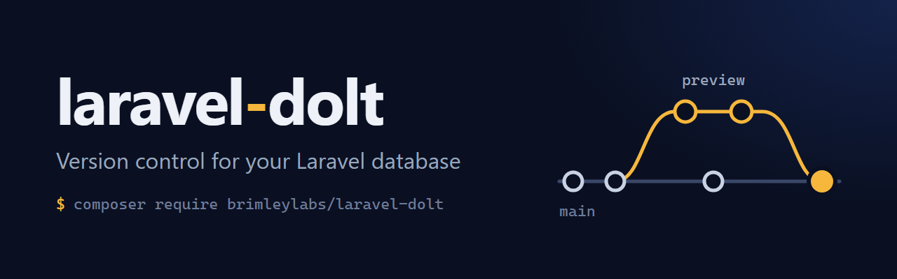
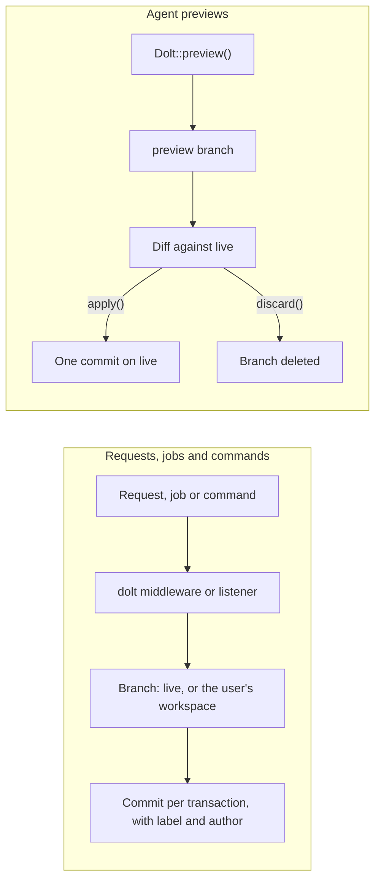

<p align="center">
    
</p>

<h1 align="center">Laravel Dolt</h1>

<p align="center">Version control for your Laravel database. Let an agent change data on a branch, review the diff, then apply it or throw it away.</p>

<p align="center">
    <a href="https://github.com/brimleylabs/laravel-dolt/actions/workflows/tests.yml"></a>
    <a href="https://packagist.org/packages/brimleylabs/laravel-dolt"></a>
    <a href="https://packagist.org/packages/brimleylabs/laravel-dolt"></a>
    <a href="LICENSE"></a>
</p>

[Dolt](https://www.dolthub.com) is a SQL database with Git built in: branches, commits, diffs, merges and time travel. This package puts all of that behind Laravel's database layer, for Dolt (MySQL protocol) and Doltgres (Postgres protocol), so Eloquent, the query builder, migrations, queues and tests keep working as they do today.

It is for teams who let AI agents and people change important data and need to see every change before it goes live, know who made it, and take it back.

```php
use BrimleyLabs\Dolt\Facades\Dolt;

// An agent does its work on a throwaway branch. Live data is untouched.
$preview = Dolt::preview(fn () => $agent->repriceCatalogue(), 'Reprice the spring catalogue');

// A person, or another agent, reads exactly what would change.
$preview->changes()->totals();          // ['tables' => 1, 'rows_added' => 0, 'rows_modified' => 212, 'rows_deleted' => 0]
$preview->changes()->rows('products');  // before and after, row by row

// Then it goes live in one commit, or disappears without a trace.
$preview->apply();
$preview->discard();

// Every request, job and command is already in the history, with its author.
Dolt::activity()->first()->subject();   // 'POST /invoices'
Dolt::revert('rh3bcpl6');               // undo one commit with a new commit
Order::asOf('2031-01-01')->find(42);    // read the past
```

## Contents

- [What you get](#what-you-get)
- [Who it is for](#who-it-is-for)
- [How it works](#how-it-works)
- [Requirements](#requirements)
- [Installation](#installation)
- [Agents](#agents)
- [Workspaces](#workspaces)
- [The audit trail](#the-audit-trail)
- [Undo](#undo)
- [Time travel](#time-travel)
- [Record history](#record-history)
- [Branches, diffs and merges](#branches-diffs-and-merges)
- [Schema changes on a branch](#schema-changes-on-a-branch)
- [Testing your application](#testing-your-application)
- [Artisan commands](#artisan-commands)
- [Configuration](#configuration)
- [What it costs](#what-it-costs)
- [Good to know](#good-to-know)
- [Doltgres limits](#doltgres-limits)
- [Testing the package](#testing-the-package)
- [Contributing](#contributing)
- [Security](#security)
- [License](#license)
- [Credits](#credits)

## What you get

- **A safe place for agents to write.** Agents work on a branch. Nothing reaches live data until the diff is approved.
- **An audit trail you do not have to build.** Every request, job, command and migration becomes a commit with an author. There is no audit table and no model events, so bulk updates and raw queries are covered too.
- **Undo.** Revert one commit, or put the whole database back to how it was at 9am.
- **Time travel.** Read any table, or the whole database, as it was at a commit, a tag or a moment in time.
- **Review before live, for people too.** Workspaces are named drafts: change any number of tables, see the diff, publish together.
- **Record history.** Any model can show who changed it, what it looked like before, and go back.
- **Schema changes on a branch.** Run a migration on a branch, test it, merge it. Schema and data travel together.

## Who it is for

- **Teams letting AI agents change production data.** The agent writes to a preview branch. A person or a second agent reads the row by row diff and applies it in one commit, or discards it.
- **Applications that need an audit trail.** Finance, health, legal and compliance work needs to show who changed what and when. Every write is a commit with an author and a label, and any past state can be read back.
- **Editorial and content workflows.** Editors draft changes across many tables in a workspace, review them, and publish them together while everyone else keeps reading live data.
- **Data operations.** A bulk import or a mass update runs on a branch first. Check the diff, merge it, and revert it if it still turns out wrong.
- **Developers testing migrations against real data.** Run the migration on a branch of the real database, read the schema diff, and merge only when it works.

## How it works

Dolt stores the history itself. The package adds a `dolt` and a `doltgres` database driver, a middleware, and listeners for queued jobs, artisan commands and migrations. Each of them labels its writes with what is running and who is behind it. In the default transaction mode Dolt then commits every SQL transaction with that label and author.



Sessions, cache, jobs and similar tables stay out of history and are shared by every branch, so a user stays signed in while working on a branch.

## Requirements

- PHP 8.2 or newer
- Laravel 12 or 13
- A Dolt SQL server, tested against Dolt 2.7.2, or a Doltgres server, tested against Doltgres 1.5.0

The full test suite runs on both servers and in both commit modes on PHP 8.2 with Laravel 12 and on PHP 8.3 with Laravel 13. The workflow in `.github/workflows/tests.yml` runs it on PHP 8.2, 8.3 and 8.4 against Laravel 12 and 13 (Laravel 13 needs PHP 8.3 or newer), on both servers and in both commit modes.

## Installation

**1. Add the package.** `dolt:install` publishes `config/dolt.php` and checks the connection.

```bash
composer require brimleylabs/laravel-dolt
php artisan dolt:install
```

**2. Point Laravel at Dolt.** The ready made `dolt` connection reuses your existing `DB_*` values.

```dotenv
DB_CONNECTION=dolt
DB_HOST=127.0.0.1
DB_PORT=3306
DB_DATABASE=shop
DB_USERNAME=root
DB_PASSWORD=
```

On Postgres, use the `doltgres` connection. It reuses the same `DB_*` values.

```dotenv
DB_CONNECTION=doltgres
DB_HOST=127.0.0.1
DB_PORT=5432
DB_DATABASE=shop
DB_USERNAME=postgres
DB_PASSWORD=password
```

**3. Add the middleware to the routes that write.** From here on, every change a request makes is committed as it happens, labelled with the request and credited to the signed in user.

```php
// bootstrap/app.php
->withMiddleware(function (Middleware $middleware) {
    $middleware->web(append: ['dolt']);
})
```

Applications that still have `app/Http/Kernel.php` add the class there instead, to a group or to the global stack.

```php
// app/Http/Kernel.php
protected $middlewareGroups = [
    'web' => [
        // ...
        \BrimleyLabs\Dolt\Http\Middleware\HandleDoltRequests::class,
    ],
];
```

**4. Migrate and check the setup.**

```bash
php artisan migrate
php artisan dolt:doctor
```

Everything in this document works the same on both servers. The few places where Doltgres is behind Dolt are listed under [Doltgres limits](#doltgres-limits).

### Running a server locally

Dolt is one binary, and it listens like MySQL does.

```bash
mkdir shop && cd shop
dolt init
dolt sql-server --port 3306
```

For Doltgres, start the server and create a database.

```bash
doltgres
psql -h 127.0.0.1 -U postgres -c "create database shop"
```

Installation and server options are in the [Dolt documentation](https://docs.dolthub.com) and the [Doltgres documentation](https://docs.doltgres.com).

## Agents

An agent should never learn on live data. Give it a preview.

```php
use BrimleyLabs\Dolt\Facades\Dolt;

$preview = Dolt::preview(function () {
    Product::where('category', 'outdoor')->increment('price', 5);
    Product::where('stock', 0)->update(['status' => 'archived']);
}, 'Reprice outdoor, archive sold out', author: 'Pricing Agent <agent@example.com>');
```

The callback ran on its own branch. Review it however you like.

```php
$changes = $preview->changes();

$changes->totals();                 // ['tables' => 1, 'rows_added' => 0, 'rows_modified' => 212, 'rows_deleted' => 0]
$changes->tables();                 // one entry per table: name, rows added, modified and deleted, schema changed or not
$changes->schema();                 // each changed table's definition before and after
$changes->patch();                  // the whole change as SQL statements

foreach ($changes->rows('products') as $row) {
    $row->key;                      // ['id' => 42]
    $row->changes();                // ['price' => ['19.00', '24.00']]
}
```

Then decide.

```php
$preview->canPublish();             // false when live data moved underneath it
$preview->apply();                  // one commit on the live branch, credited to the agent
$preview->discard();                // gone
```

The commit carries the preview's title and author. Whoever approves can sign it instead with `$preview->apply('Approved by Dana', $user)`. If the callback throws, the preview is discarded and the exception is rethrown. Whatever the callback returned is on `$preview->result`.

A preview outlives the request that made it. Keep its name and pick it up later, from an approval screen or a queued job.

```php
$name = $preview->name;

$preview = Dolt::previews()->get($name);
Dolt::previews()->all();            // every open preview
```

`php artisan dolt:workspaces --previews` lists them too. Previews nobody acted on for 24 hours are removed by `php artisan dolt:prune`. Schedule it daily, and change the window with `--hours` or `previews.expire_after_hours` in the config file.

For longer agent sessions, use a named branch and work on it for as long as you need.

```php
Dolt::createBranch('agent/import-2031');

Dolt::on('agent/import-2031', function () {
    // Every query in here runs on the branch.
    $importer->run();
    Dolt::commit('Import the 2031 price list', 'Import Agent <agent@example.com>');
});

Dolt::diff('main', 'agent/import-2031')->totals();
Dolt::checkout('main')->merge('agent/import-2031');
```

## Workspaces

A workspace is a named draft for people. Open one, change anything in it, publish it all together.

```php
$workspace = Dolt::workspaces()->open('Spring Sale');

Dolt::workspaces()->enter($workspace);   // this user's requests now read and write the draft
Dolt::workspaces()->leave();             // back to live data

$workspace->changes();                   // what publishing would do
$workspace->conflicts();                 // where live data changed underneath it
$workspace->sync();                      // bring live changes into the draft
$workspace->publish();                   // merge into live
$workspace->discard();
```

The `dolt` middleware does the routing. A user inside a workspace sees their draft on every page. Everyone else sees live data. Sessions, cache and jobs are shared across branches, so the user stays signed in.

`Dolt::workspaces()->current()` is the workspace the current user is in, and `firstOrOpen('Spring Sale')` finds a workspace or opens it. `publish()` takes `onConflict:`, `squash: true` to land the draft as one commit, and `keep: true` to leave the workspace open afterwards.

## The audit trail

With the middleware in place there is nothing to do.

```bash
php artisan dolt:log
```

```
+----------+------------------+---------+----------------------------------------------+
| Commit   | Date             | Author  | Message                                      |
+----------+------------------+---------+----------------------------------------------+
| rh3bcpl6 | 2031-03-02 14:42 | Dana    | POST /invoices (3 commits)                   |
| b9alidon | 2031-03-02 14:41 | Dana    | PUT /books/field-guide                       |
| mr3a6esp | 2031-03-02 14:40 | Laravel | artisan db:seed (6 commits)                  |
| rjh6gja2 | 2031-03-02 14:40 | Laravel | Run migration 2031_03_01_create_books_table  |
+----------+------------------+---------+----------------------------------------------+
```

By default Dolt commits each SQL transaction the moment it ends. The commit is labelled with the request, job or command it belongs to and credited to whoever made it, so the history stays exact when many people write at once.

- A web request is labelled with its method and path and credited to the signed in user. Each write outside `DB::transaction()` is a commit of its own, so a request that writes three times outside a transaction makes three commits. Wrap writes that belong together in one transaction to record them as one change.
- A queued job is labelled with the job's name. An artisan command is labelled with the command, and commands it runs along the way share that label.
- Each migration is labelled with its file name. Dolt commits every schema statement on its own, so one migration can be several commits with the same label. On Doltgres a migration is one commit, plus one for Laravel's record of it.
- A request, job or command that only reads adds nothing.

Every commit carries the request, job or command it belongs to. `dolt:log` uses that to show one line per request, job or command, with the number of commits it made, such as `POST /invoices (3 commits)`. Pass `--all` to list every commit.

```bash
php artisan dolt:log --all
php artisan dolt:log main --limit=50
```

Give the commits a better message from anywhere in the request, job or command. It names the commits that follow it, so call it before the writes.

```php
Dolt::message('Approve invoice 1042');
```

### Reading the trail in code

`Dolt::activity()` is the same view as `dolt:log`: a Collection of `BrimleyLabs\Dolt\Data\Activity` objects, one per request, job or command, newest first. It takes a ref and a limit, `Dolt::activity($ref = null, $limit = 20)`.

```php
$activity = Dolt::activity()->first();

$activity->subject();               // 'POST /invoices'
$activity->author()->name;          // 'Dana'
$activity->date();                  // when its newest commit was made
$activity->count();                 // 3
$activity->commits;                 // the three Commit objects, newest first
$activity->head();                  // the newest commit
$activity->base();                  // the commit before the activity began

// Everything one request changed, as one diff.
Dolt::diff($activity->base(), $activity->head()->hash)->rows('invoices');
```

A commit that belongs to no request, job or command, such as a merge, is an activity of its own. `Dolt::log()` still returns every commit.

### One commit per request

Set `DOLT_COMMIT_MODE=request` to record each request, job, command and migration run as a single commit when it ends. Failed requests are then marked with their status, such as `[422]`, or with `(failed)` when they died without a response, and the log reads one line per request.

Use it only when one process writes to a branch at a time. A Dolt commit takes everything pending on the branch, so when requests overlap, one request's commit can carry another's writes under the wrong name. If a commit fails it is tried once more. If it fails again it is reported, `BrimleyLabs\Dolt\Events\CommitFailed` is fired, and the writes wait for the next commit.

Commit by hand whenever you want a boundary of your own.

```php
Dolt::commit('Close the March books', $user);
```

## Undo

```php
Dolt::revert('rh3bcpl6');               // undo one commit with a new commit
Dolt::reset();                          // throw away changes that are not committed
```

`revert()` is the safe undo: history keeps the mistake and the fix. `reset()` moves the branch itself back, and the commits after that point leave its history. On the default branch those can be other people's work, so it asks for `force`.

```php
$previous = Dolt::reset(now()->subHour(), force: true);   // put live data back to how it was an hour ago
Dolt::reset($previous, force: true);                       // changed your mind
```

Workspaces and other branches move back without `force`. Uncommitted changes that `reset()` threw away cannot be brought back.

Anywhere a point in history is expected you can pass a branch, a tag, a commit, the short hash that `dolt:log` prints, a date object, or a date written as text such as `'2031-01-01'` or `'2031-01-01 09:00'`. Dates written as text are read in your application timezone.

## Time travel

```php
// One query.
Order::asOf('v1.4')->find(42);
DB::table('orders')->asOf(now()->subWeek())->where('status', 'open')->count();

// Everything inside the callback, relationships included.
Dolt::asOf('2031-01-01', fn () => Report::quarterly());

// Name a moment so you can come back to it.
Dolt::tag('before-migration');
```

`asOf()` on a query moves only the table the query starts from. Joined tables and eager loaded relationships read current data. Wrap the code in `Dolt::asOf()` to move everything at once. The connection is read only inside that callback.

## Record history

```php
use BrimleyLabs\Dolt\Eloquent\Versioned;

class Invoice extends Model
{
    use Versioned;
}
```

```php
$invoice->history();                            // every change, newest first, with its commit and author
$invoice->lastCommit()->author->name;           // who touched it last
$invoice->versionAt(now()->subMonth());         // the record as it was
$invoice->changesBetween('before-migration');   // how it differs from then
$invoice->revertTo('before-migration');         // put it back

Invoice::deletedSince(now()->subDay());         // records deleted in the last day
Invoice::restoreFrom(now()->subDay(), 42);      // bring one back
```

Nothing is stored for this. The history comes from Dolt, so changes made by bulk updates, raw queries and other applications are in it too. Hidden attributes are left out of `history()` unless you pass `withHidden: true`.

## Branches, diffs and merges

```php
Dolt::createBranch('staging');
Dolt::checkout('staging');
Dolt::on('staging', fn () => Product::count());

Dolt::diff('main', 'staging');              // a ChangeSet, as above
Dolt::previewMerge('staging');              // conflicts a merge would hit, without merging

Dolt::merge('staging');                                 // stops on conflict, nothing changes
Dolt::merge('staging', onConflict: 'theirs');           // or 'ours'
Dolt::merge('staging', onConflict: ['prices' => 'ours', 'products' => 'theirs']);
```

A merge that stops on a conflict throws `BrimleyLabs\Dolt\Exceptions\MergeConflictException` and leaves the branch as it was. A strategy per table can use `'*'` as the fallback. For full control, pass a closure. It is called with each conflicting row and returns `'ours'`, `'theirs'`, or an array of column values to write. Anything else stops the merge.

```php
use BrimleyLabs\Dolt\Data\Conflict;

Dolt::merge('staging', onConflict: fn (Conflict $conflict) => $conflict->theirs === null ? 'ours' : 'theirs');
```

A merge always records a merge commit, so the history shows when a branch came in. Pass `squash: true` to land the branch as one ordinary commit, or `fastForward: true` to move the branch pointer when nothing else has changed.

Point each environment at its own branch and they can share one server.

```dotenv
DOLT_BRANCH=staging
```

## Schema changes on a branch

Migrations are commits like everything else, so a schema change can be tried on a branch first.

```php
Dolt::createBranch('add-reading-time');

Dolt::on('add-reading-time', fn () => Artisan::call('migrate', ['--force' => true]));

Dolt::diff('main', 'add-reading-time')->patch();    // the ALTER statements
Dolt::checkout('main')->merge('add-reading-time');  // schema and data arrive together
```

A migration that went wrong is one `Dolt::revert()` away. The table change and Laravel's own migration record go back together.

## Testing your application

A Dolt commit ends the open transaction, so the usual roll back after each test cannot contain code that commits or branches. Use the Dolt trait instead. It migrates once, then puts data, schema, branches and tags back before every test.

```php
use BrimleyLabs\Dolt\Testing\RefreshDoltDatabase;

class CheckoutTest extends TestCase
{
    use RefreshDoltDatabase;
}
```

To refresh a connection other than the default, give the test a `$doltConnection` property with its name.

Laravel only raises console command events in tests when asked. To test the commit an artisan command makes, add `Illuminate\Foundation\Testing\WithConsoleEvents` to the test.

## Artisan commands

| Command | What it does |
| --- | --- |
| `dolt:install` | Publish the config file and check the connection |
| `dolt:doctor` | Check the connection and how history is being recorded |
| `dolt:status` | The current branch and what is not committed yet |
| `dolt:log` | History, newest first, one line per request, job or command. `--all` lists every commit |
| `dolt:diff` | What changed between two points, by table or row by row with `--table` |
| `dolt:commit` | Commit every pending change |
| `dolt:branch` | List, create or delete branches |
| `dolt:merge` | Merge a branch, with `--dry-run`, `--ours`, `--theirs` and `--squash` |
| `dolt:workspaces` | Open workspaces and what each would change. `--previews` lists previews |
| `dolt:prune` | Discard previews nobody applied |
| `dolt:ignore` | Keep tables such as sessions and cache out of version control |

Every command except `dolt:install` takes `--database=` to work with a Dolt connection other than the default.

## Configuration

`php artisan dolt:install` publishes `config/dolt.php`.

| Setting | Environment | Default | Meaning |
| --- | --- | --- | --- |
| `connection` | `DOLT_CONNECTION` | the default connection | The connection the facade and middleware work with. It must use the `dolt` or `doltgres` driver |
| `branch` | `DOLT_BRANCH` | the database default | The branch this environment works on |
| `author` | `DOLT_AUTHOR_NAME`, `DOLT_AUTHOR_EMAIL` | the application name | Who is credited when nobody is signed in |
| `commit.mode` | `DOLT_COMMIT_MODE` | `transaction` | `transaction` commits every SQL transaction as it happens, credited exactly. `request` makes one commit per request, job or command, for branches with one writer at a time |
| `commit.queue`, `commit.console`, `commit.migrations` | | `true` | Switch automatic commits off per source |
| `adjustments` | `DOLT_ADJUSTMENTS` | `warn` | What happens when a statement has to be adjusted to run, such as a cascade rule on a shared table or a row lock on Doltgres: `warn` logs it, `allow` stays quiet, `fail` throws. The `StatementAdjusted` event fires either way |
| `ignore` | | sessions, cache, jobs and similar | Tables kept out of history and shared by every branch. `%` matches any run of characters |
| `workspaces.prefix` | | `workspace/` | The branch name prefix for workspaces |
| `previews.prefix`, `previews.expire_after_hours` | | `preview/`, `24` | The branch name prefix for previews, and when `dolt:prune` removes them |
| `timezone` | | the application timezone | The timezone commit dates are shown in |

Choose the author, branch and commit message yourself when the defaults do not fit.

```php
Dolt::resolveAuthorUsing(fn ($request) => $request->user()?->only('name', 'email'));
Dolt::resolveBranchUsing(fn ($request) => $request->header('X-Branch'));
Dolt::describeRequestUsing(fn ($request) => $request->route()?->getName());
```

`Dolt::connection('name')` works with any other Dolt connection. Calls on the facade go to the default one.

## What it costs

Measured end to end through Laravel's HTTP kernel: 200 requests per case, the cases taking turns in rounds, PHP 8.2 and Laravel 12 on an Apple M5 Pro with the database server on the same machine. "Laravel driver" is the same database through Laravel's own `mysql` or `pgsql` driver with nothing from this package involved. Times are the median and the 95th percentile in milliseconds.

**Dolt 2.7.2**

| Case | Read | Write one row | Write three rows |
| --- | --- | --- | --- |
| Laravel driver, no package | 0.58 / 0.70 | 6.19 / 7.09 | 15.06 / 16.13 |
| `dolt` driver, no middleware | 0.58 / 0.68 | 6.09 / 7.09 | 15.04 / 16.08 |
| `dolt` middleware, transaction mode | 0.63 / 0.73 | 7.00 / 8.11 | 16.71 / 18.17 |
| `dolt` middleware, request mode | 0.62 / 0.74 | 11.88 / 13.05 | 20.90 / 22.15 |

**Doltgres 1.5.0**

| Case | Read | Write one row | Write three rows |
| --- | --- | --- | --- |
| Laravel driver, no package | 1.20 / 1.28 | 7.06 / 8.16 | 18.03 / 18.94 |
| `doltgres` driver, no middleware | 1.21 / 1.33 | 7.05 / 8.01 | 18.03 / 19.15 |
| `doltgres` middleware, transaction mode | 1.30 / 1.43 | 10.00 / 13.26 | 24.99 / 29.28 |
| `doltgres` middleware, request mode | 1.29 / 1.61 | 15.98 / 17.45 | 26.96 / 28.49 |

What that means:

- The driver costs nothing you can measure, and a request that only reads costs a tenth of a millisecond or less.
- What a write costs is the commit itself, which the Laravel driver never makes. In transaction mode Dolt adds about 0.8 ms per write and Doltgres about 3 ms. Request mode makes one larger commit at the end, about 6 ms on Dolt and 9 ms on Doltgres, however many rows the request wrote.
- A database on another machine adds its network round trips on top, the same as it does for any query.

Run it yourself with `vendor/bin/phpunit benchmarks/OverheadBench.php`, with the same `DOLT_TEST_*` settings as the test suite.

## Good to know

- **Sessions, cache and jobs stay out of history.** Tables on the `ignore` list are set up when migrations first run on a new database. If your database already versions one of them, run `php artisan dolt:ignore` once, then `sync()` any workspace opened before that.
- **Create shared tables on the default branch.** Tables on the `ignore` list have to be created there to be visible from every branch.
- **Version control calls happen outside transactions.** A Dolt commit ends the open SQL transaction, so `commit()`, `reset()`, `revert()` and `merge()` throw when called inside `DB::transaction()`. They also throw inside `Dolt::asOf()`, which is read only.
- **Applications written for MySQL with strict mode off.** MySQL fills in a required column that an insert leaves out. Dolt does not. When a connection has `'strict' => false`, the package writes those defaults into columns as migrations create them, so such applications run unchanged. Set `'implicit_defaults'` on the connection to force it on or off.
- **Cascade rules on shared tables.** Dolt does not allow `on delete` or `on update` rules on a foreign key that touches a table on the `ignore` list. The package leaves such a key out when a migration asks for one, so packages like Telescope install cleanly, and logs a warning naming the key. Foreign keys on versioned tables are untouched. See `adjustments` under [Configuration](#configuration) to silence the warning or refuse instead.
- **Queued jobs run on the worker's branch.** A job dispatched from inside a workspace runs against the worker's home branch, not the workspace. Pass the workspace name to the job and use `Dolt::on()` when it should write to the draft.
- **Long running workers.** Octane and queue workers are returned to their home branch between requests and jobs.
- **Author names.** A signed in user is credited by `name`, then `first_name` and `last_name`, then `username`, then the first part of the email. Use `Dolt::resolveAuthorUsing()` when your users are named some other way.
- **Commit dates.** Dolt stamps commits with the server clock in UTC. They are shown in your application timezone, or the `timezone` setting.

## Doltgres limits

Doltgres is younger than Dolt. The package covers the gaps it can, and these are the ones worth knowing about. They were found on Doltgres 1.5.0. Row locks and `ilike` are checked against the server the first time they are used, so a newer Doltgres that supports them gets the real statement. `php artisan dolt:doctor` shows which workarounds are in use.

- **Row numbers in shared tables.** Doltgres has no counter that every branch can share, so tables on the `ignore` list, such as `jobs`, number their rows from the clock: the time in microseconds followed by three random digits. The numbers are in insert order but 19 digits long, past the largest whole number JavaScript holds exactly, so send them to a browser as strings. Two rows written in the same microsecond clash one time in a thousand. Outside a transaction the insert is simply tried again. Inside one it fails with a duplicate key error, and the transaction can be retried.
- **Row locks.** Doltgres does not lock rows yet. `lockForUpdate()` and `sharedLock()` run as plain queries, and the first one on each table logs a warning. When two sessions change the same row, the second one fails when its transaction commits, so nothing is written twice. Two queue workers that reach for the same job are settled the same way: one takes it and the other reports a serialization failure and moves on. Set `DOLT_ADJUSTMENTS=allow` once you have read this, or `fail` to refuse such queries.
- **Strict mode.** The `'strict' => false` accommodation under [Good to know](#good-to-know) is for MySQL applications and does nothing on Doltgres.
- **Case-insensitive search.** `ilike` is rewritten as a comparison of lowered text, which matches the same rows.

## Testing the package

```bash
composer test:unit                                   # no server needed
DOLT_TEST_PORT=3306 composer test
DOLT_TEST_DRIVER=pgsql DOLT_TEST_PORT=5432 composer test
DOLT_TEST_COMMIT_MODE=request DOLT_TEST_PORT=3306 composer test
composer lint && composer analyse                    # Pint and Larastan
```

Each test creates and drops its own database on the server you point it at. The same tests run against both servers and in both commit modes. Run one suite at a time per server: Dolt 2.7.2 can fail an `information_schema` query in one session while another session drops a database.

## Contributing

Pull requests are welcome. Before you open one, run `composer test:unit`, `composer lint` and `composer analyse`, then the full suite against both a Dolt and a Doltgres server as shown under [Testing the package](#testing-the-package).

## Security

Report security issues privately through [GitHub security advisories](https://github.com/brimleylabs/laravel-dolt/security/advisories/new). Do not open a public issue for them.

## License

MIT. See [LICENSE](LICENSE).

## Credits

Built on [Dolt](https://github.com/dolthub/dolt) and [Doltgres](https://github.com/dolthub/doltgresql) by [DoltHub](https://www.dolthub.com).
